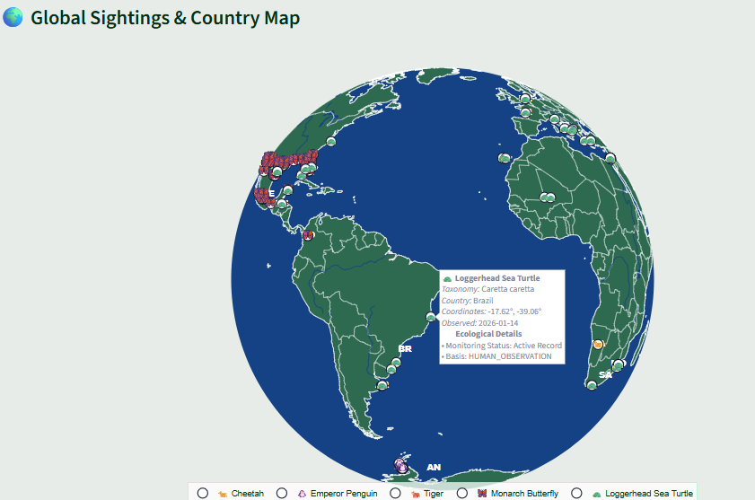
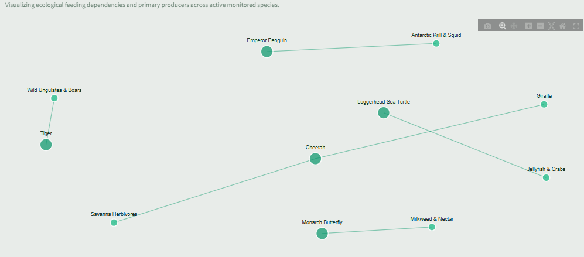
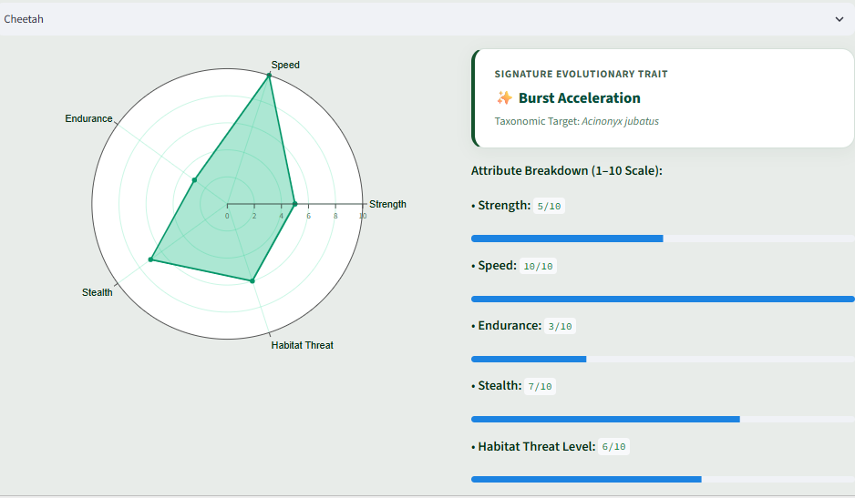

# 🌿 WildTrack | Biodiversity & Species Migration Explorer

An end-to-end geospatial analytics and ecological intelligence web application. WildTrack bridges global scientific APIs, cloud-hosted relational data storage, 3D cartographic rendering, and large language models (LLMs) to monitor wildlife sightings, model trophic networks, and evaluate habitat preservation risks.

[](https://www.python.org/)
[](https://streamlit.io/)
[](https://supabase.com/)
[](https://plotly.com/)
[](https://www.deepseek.com/)

---

## 📸 Platform Highlights

<!-- Tip: Store your screenshots in a docs/screenshots/ directory inside this repository -->
<p align="center">
  
  <br>
  <em>Figure 1: 3D Orthographic Earth Biosphere with localized cluster density halos, centered territory codes, and dynamic animal emoji markers.</em>
</p>

<p align="center">
  
  
  <br>
  <em>Figure 2: Interactive Trophic Food Web (Left) and AI-generated Species Vitality Radar & Trait Profile (Right).</em>
</p>

---

## 🌟 Key Capabilities

### 1. 3D Geospatial Biosphere & Territorial Inspection
* **Real Earth Orthographic Globe:** Custom-styled natural earth projection featuring satellite marine blues, terrestrial foliage greens, and defined geopolitical coastlines with full rotational capability and fixed camera bounds.
* **3-Tier Localized Indicator System:**
  * **Species Pins:** Exact GPS georeferenced markers tagged with dynamic taxonomy-resolved animal icons ($\text{e.g., } 🐆, 🐧, 🦅, 🐢$).
  * **Density Halos:** Proximity-grouped translucent rings that scale and transition from Emerald ($<5$) to Amber ($5-14$) to Crimson ($15+$) based purely on local occurrence concentration.
  * **Interactive Bio-Cards:** Rich metadata hover cards detailing scientific binomials, verified GBIF protocols, coordinates, and observation dates.
* **Non-Colliding Territory Badges:** Bold geopolitical country codes ($\text{e.g., } [US], [NA], [ES]$) stamped directly onto territorial centroids.
* **Country Audit Drill-Down:** Itemized regional inspection suite featuring a global territory leaderboard, nation-specific sighting filters, and raw GPS occurrence logs.

### 2. Multi-Dimensional Ecological Analytics Studio
* **Interactive Trophic Food Web:** Directed graph built with `NetworkX` mapping active species to trophic connectors, primary producers, forage targets, and apex predators.
* **Spatial & Latitudinal Profiles:** Latitudinal distribution histograms tracking equatorial vs. polar migration preferences across global climate bands ($-90^\circ$ to $+90^\circ$).
* **12-Month Migration Heatmap:** Matrix calendar aggregating chronological event dates across all 12 calendar months to detect seasonal breeding and migration spikes.

### 3. Automated Conservation Intelligence (DeepSeek API)
* **Biological Trait Radar (1–10 Ratings):** Algorithmic scoring evaluating strength, speed, endurance, stealth, and threat vulnerability paired with signature evolutionary skills.
* **Interspecies Comparative Review:** Side-by-side comparative analysis of dietary niches, geographic fragmentation, and synergistic protection strategies for two selected species.
* **Interactive Field Specialist Q&A:** Context-grounded conversational agent answering complex behavioral, territorial, and dietary inquiries using monitored observation parameters.
* **Fuzzy Search & Typo Auto-Correction:** Natural language query interceptor resolving colloquial or misspelled inputs ($\text{e.g., } \text{"cheta"} \rightarrow \text{Cheetah / } \textit{Acinonyx jubatus}$).

---

## 🏗️ System Architecture & Data Flow

```text
[ Global Biodiversity Information Facility (GBIF) REST API ]
                                │
                                ▼  (Taxonomic Resolution & HTTPS Fetch)
            [ Python Ingestion Engine (gbif_client.py) ]
                                │
                                ▼  (Upsert Occurrences & GPS Metadata)
                [ Supabase Cloud PostgreSQL DB ]
                                │
                                ▼  (SQL Query / DataFrame Hydration)
               [ Streamlit Core Engine (app.py) ]
                ┌───────────────┼───────────────┐
                ▼               ▼               ▼
      [ Plotly 3D Globe ]  [ NetworkX Web ]  [ DeepSeek LLM API ]
       (Geospatial Map)    (Trophic Links)   (Conservation AI)
```

---

## 🛠️ Technology Stack

| Domain | Technology | Purpose |
| :--- | :--- | :--- |
| **Frontend UI** | Streamlit | Responsive dashboard, session-state management, frosted glass UI |
| **Data Visualization** | Plotly Graph Objects & Express | 3D orthographic globe, radar spider charts, monthly heatmaps |
| **Network Analysis** | NetworkX | Directed graph modeling for multi-species trophic interactions |
| **Data Processing** | Pandas, NumPy | Vectorized GPS transformations, date parsing, aggregation |
| **Database** | PostgreSQL / Supabase | Relational persistence of occurrence records and species metadata |
| **External API** | GBIF Occurrence API | Live global biodiversity observation records |
| **Artificial Intelligence** | DeepSeek API | Natural language conservation reports and 1–10 trait scoring |

---

## 🚀 Getting Started Locally

### Prerequisites
* Python 3.10 or higher
* Active Supabase project (PostgreSQL)
* DeepSeek API Key

### Installation

1. **Clone the repository:**
   ```bash
   git clone https://github.com/<your-username>/wildtrack-biodiversity-explorer.git
   cd wildtrack-biodiversity-explorer
   ```

2. **Create and activate a virtual environment:**
   ```bash
   # Windows (PowerShell)
   python -m venv .animals
   .animals\Scripts\activate

   # macOS/Linux
   python3 -m venv .animals
   source .animals/bin/activate
   ```

3. **Install dependencies:**
   ```bash
   pip install streamlit pandas numpy plotly networkx requests python-dotenv openai supabase
   ```

4. **Configure environment variables:**
   Create a `.env` file in the project root:
   ```env
   SUPABASE_URL=your_supabase_project_url
   SUPABASE_KEY=your_supabase_anon_or_service_key
   DEEPSEEK_API_KEY=your_deepseek_api_key
   ```

5. **Launch the application:**
   ```bash
   streamlit run app.py
   ```

---

## 📊 Database Schema

The cloud database operates on a relational schema ensuring referential integrity across taxa and observations:

```sql
-- Master Species Metadata Table
CREATE TABLE IF NOT EXISTS species (
    id SERIAL PRIMARY KEY,
    scientific_name TEXT UNIQUE NOT NULL,
    common_name TEXT NOT NULL,
    taxonomic_group TEXT
);

-- Georeferenced Sightings Fact Table
CREATE TABLE IF NOT EXISTS occurrences (
    occurrence_id TEXT PRIMARY KEY,
    scientific_name TEXT NOT NULL REFERENCES species(scientific_name) ON DELETE CASCADE,
    country TEXT,
    latitude DOUBLE PRECISION NOT NULL,
    longitude DOUBLE PRECISION NOT NULL,
    event_date DATE,
    basis_of_record TEXT
);
```

---

## 📜 License & Acknowledgments
* Observational biodiversity records provided by the [Global Biodiversity Information Facility (GBIF)](https://www.gbif.org/).
* Automated reasoning powered by [DeepSeek](https://www.deepseek.com/).
* Developed as an applied data science capstone project.